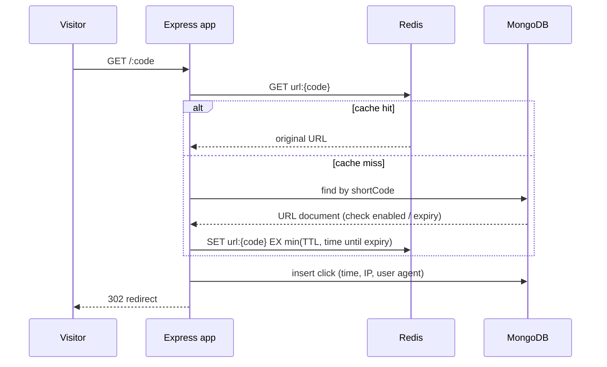

<div align="center">

# 🔗 URL Shortener — v1 (Express + Redis)

**The first version of [Shortly](https://url-shortener-frontend-t-aryan.vercel.app): a single Express service with a Redis cache in front of MongoDB.**


</div>

> ### 📦 This repo is kept for reference
> The current, deployed project lives in two repos:
>
> | | Repo | Live |
> |---|---|---|
> | ⚛️ Frontend (React, Vercel) | [url-shortener-frontend](https://github.com/ARYAN10227/url-shortener-frontend) | [▶ Open the app](https://url-shortener-frontend-t-aryan.vercel.app) |
> | 🟢 REST API (Express, MongoDB, Render) | [url-shortener-api](https://github.com/ARYAN10227/url-shortener-api) | [📘 Swagger docs](https://url-shortener-api-h1dj.onrender.com/api-docs) |
> | 📊 Click analytics pipeline (Kafka → ClickHouse) | [clickstream-pipeline](https://github.com/ARYAN10227/clickstream-pipeline) | [🎬 Demo video](https://youtu.be/em_TnU8WQkU) |

---

## ✨ What v1 does

- **Short links** with a random code or a custom alias, optional **expiry dates**, and an enable/disable switch
- **JWT authentication** (register, log in, `GET /api/auth/me`) with per-user link ownership
- **Redis cache-aside on redirects** — the hot path (`GET /:code`) is served from Redis when possible
- **Click analytics** stored in MongoDB: timestamp, IP and user agent for every click
- **OpenAPI docs** served with Swagger UI
- **Docker Compose** stack (app + MongoDB + Redis) and a GitHub Actions CI workflow

## ⚡ How the redirect cache works



- The cache TTL never outlives the link: it's capped at the link's remaining lifetime when it has an expiry.
- **Updating, disabling or deleting** a link deletes its Redis key, so stale redirects are never served.

## 🔄 v1 → current version

| | v1 (this repo) | Current ([api](https://github.com/ARYAN10227/url-shortener-api) + [frontend](https://github.com/ARYAN10227/url-shortener-frontend)) |
|---|---|---|
| Shape | One Express service, routes in one file | Layered API (routes / controllers / middleware / utils) + React SPA |
| Redirect hot path | Redis cache-aside | Direct indexed MongoDB lookup (one fewer service to run on free hosting) |
| UI | None (API + Swagger) | Full dashboard, analytics pages, one-click demo |
| Hardening | Helmet, JWT | + rate limiting per client IP, reserved codes, JSON error handling, demo guard rails |
| Hosting | Docker Compose | Vercel + Render + MongoDB Atlas, with a keep-alive job |
| Analytics at scale | Clicks in MongoDB | Streaming pipeline: [ClickPipe](https://github.com/ARYAN10227/clickstream-pipeline) (Redpanda → ClickHouse, 20K events/s) |

## 🚀 Run it locally

```sh
git clone https://github.com/ARYAN10227/url-shortener.git
cd url-shortener
cp .env.example .env
docker compose up --build      # app on http://localhost:3000, with MongoDB and Redis
```

API docs are then at `http://localhost:3000/api-docs`.

## ⚙️ Production configuration

Configure the container with environment variables. Do not add a production `.env` file to an image or
source control; use your deployment platform's secret manager instead. Copy `.env.production.example` only
as a reference.

| Variable | Purpose |
| --- | --- |
| `PORT` | HTTP port for the application. Defaults to `3000`. |
| `MONGODB_URI` | Required MongoDB connection URI, such as a MongoDB Atlas URI. |
| `REDIS_URL` | Required Redis connection URI in production. |
| `JWT_SECRET` | Required secret used to sign authentication tokens. |

The production image has no database services inside it; provide externally reachable MongoDB and Redis URLs.

## ❤️ Health check

`GET /health` returns `200` with `{ "status": "ok" }` when the HTTP service is running — suitable for a
container or load-balancer health check.

---

<div align="center">

Built by **Aryan Raj** ·
[GitHub](https://github.com/ARYAN10227) ·
[LinkedIn](https://linkedin.com/in/aryan-raj-2b3868340)

</div>
